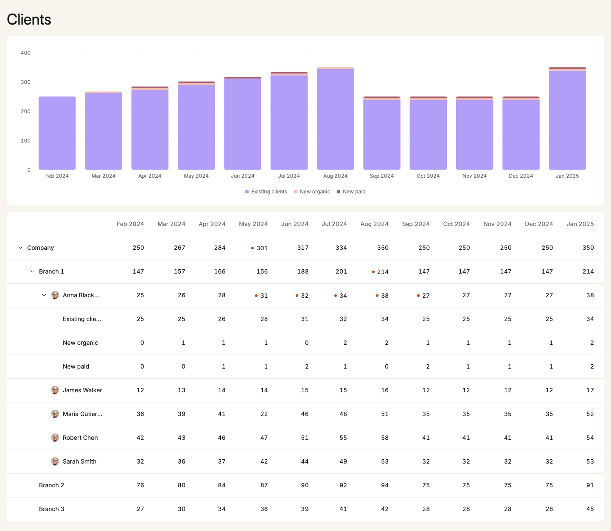
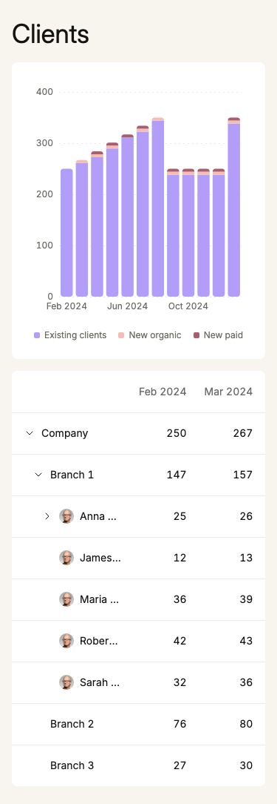
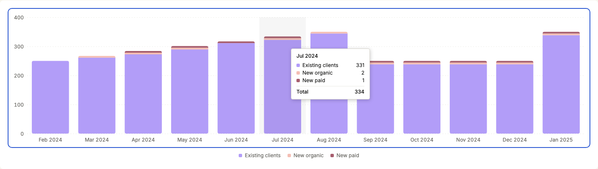
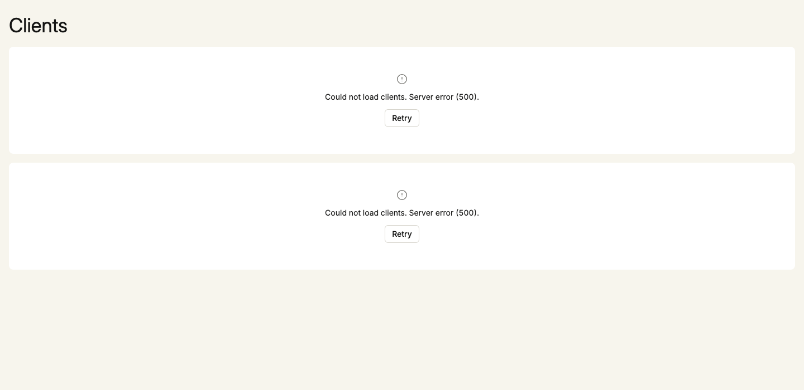

# Clients dashboard

A stacked bar chart and an expandable tree table over the client data, served by a Node.js REST API.

| 375px                                 | Chart from the keyboard                                 | Load error                           |
| ------------------------------------- | ------------------------------------------------------- | ------------------------------------ |
|  |  |  |

## Run it

You need [nvm](https://github.com/nvm-sh/nvm).

1. `nvm install` - Node 26 from `.nvmrc`
2. `npm i -g pnpm@12` - Node 26 ships without corepack
3. `pnpm i`
4. `pnpm dev` - web app on http://localhost:5173, API on http://localhost:8787

## Test it

| Command            | What it does                                                                                                                                           |
| ------------------ | ------------------------------------------------------------------------------------------------------------------------------------------------------ |
| `pnpm check`       | lint (0 warnings), format check, typecheck, unit tests in every package (147 tests)                                                                    |
| `pnpm e2e:install` | installs Chromium for the browser tests, once per machine                                                                                              |
| `pnpm check:e2e`   | builds the web app, starts the API (8787) and the preview (4173), runs 49 Playwright tests. The ports must be free, so stop `pnpm dev` first           |
| `pnpm storybook`   | every UI component and both cards in every load state, with the accessibility addon, on http://localhost:6006                                          |
| `pnpm screenshots` | regenerates the pictures above                                                                                                                         |
| `pnpm generate`    | regenerates types, client and mocks from `packages/api-contract/openapi.yaml`; `pnpm check:generated` fails when the committed generated code is stale |

What the tests cover:

- **Expand / collapse** (`apps/frontend/e2e/table.e2e.ts`): mouse, keyboard, closing a parent closes its children, leaf rows do nothing, `treegrid` levels and expanded states, 375px, axe.
- **Data to chart** (`clients-chart/chart-series.test.ts`, `ui/bar-chart/bar-chart-model.test.ts`): the split per month (Feb 250/0/0, Jul 331/2/1, Jan 346/2/2), every bar = the stored Company value, extra or missing channels, stacking, rounded corners, minimum part height, tooltip text. In the browser: axis, legend, tooltip, keyboard stepping, data table (`e2e/chart.e2e.ts`).
- **Load states** (`e2e/dashboard.e2e.ts`): real API, slow / fast load, 500 with one retry, Retry and its focus, timeout, network error, non-JSON body, offline, crash fallback; axe in each state at 375 and 1440px. Mocks are fixed responses through MSW, never random data.
- **Performance** (`e2e/perf.e2e.ts`, CPU throttled 4x): initial JS 143 kB gzip (budget 200), LCP ~290 ms, CLS 0, every interaction paints within 200 ms.

Loading and error states by hand: open the `ChartCard` / `TableCard` stories, or stop the API while `pnpm dev` runs and reload.

## How it is built

pnpm workspace: `apps/backend` (Hono), `apps/frontend` (React 19, Vite, TanStack Query, react-aria-components, Tailwind 4, ECharts), `packages/api-contract` (OpenAPI -> orval: TS types, query client, MSW mocks), `packages/utils`.

The frontend has three layers, enforced by ESLint: `ui/` is domain-free (Card, Button, Table, BarChart, ...), `features/clients/` maps the data to `ui/` props, `app/` composes the page. Every component has one job: `ClientsLoader` is the only one that fetches and shows the loading and error states (taking the TanStack Query result as is) and hands the data to `ClientsDashboard`; the cards, the table and the chart only render the data they get; state and side effects sit in named hooks (`useExpandedRows`, `useDataIssues`, `useCategoryKeyboard`, ...). The plan, task split and every decision in detail: [PLAN.md](PLAN.md).

## Text and languages

All user-facing text is in one typed catalog, `apps/frontend/src/i18n/en.ts` (shape: `messages.ts`); components read it with `useI18n()`, `ui/` components get their text as props. Text with values is a function (`load.error(reason)`, `chart.label(from, to)`), so a translation can order the words its own way; numbers and months are formatted for the locale with `Intl`. Adding a language = a second catalog of type `Messages` and its locale in `app/providers.tsx`; the provider also sets the page's `lang` and title. The `GermanFormatting` stories show `de-DE` formatting (months and numbers). Not translated: channel names (they come from the data), the data issue reports (dev console / Sentry), and the `: ` / `, ` separators of the chart's month text.

Why no i18n library: one language, ~25 strings and no plurals, so a typed catalog plus `Intl` does the job with compile-time checks and 0 kB. With real translations, plurals or a translation tool, switch to react-intl or Lingui; every text is already behind `useI18n()`, so the components would not change (details at the top of `i18n/messages.ts`). Still to do: pass the locale to react-aria-components' own `I18nProvider` too, for its built-in screen-reader text and right-to-left layout.

## Assumptions

- **The API serves the data unchanged** and adds `months` (`2024-02` .. `2025-01`): the payload has no dates, the brief gives the period. No totals are corrected, no levels filled in.
- **The table shows stored values**, never sums of children.
- **The chart is the whole company, stacked by channel.** Only Anna Blackwood has a channel breakdown, so summing channels would give about 25 clients instead of 250. "Existing clients" is therefore the Company value minus all other channels (never below 0), so every bar reaches the Company total; any other channel in the data gets its own series. This is a guess, see the open questions.
- **Start state**: Company open, everything else closed. **Closing a row closes its open children**, so reopening shows them closed.
- **No runtime validation**: both sides use the TypeScript types generated from `openapi.yaml`, and the fixture is checked with `satisfies`. The value rules the types cannot express (12 values, integers >= 0, UUIDs) are documented in the contract, not enforced.
- **Data checks run in the frontend for now**, only to ship faster; they belong with the data owner (see below).
- **Every data integrity issue is reported**, once per issue and page load, through `reportDataIssue` (`apps/frontend/src/reporting/`): in the dev console today, to Sentry once it is set up (the call is written there as a TODO). The UI still shows the stored values.
- **Advisor photos are static files by id** (`/avatars/<advisorId>.jpg`, the same placeholder photo for all five): the data has no photo field. The API serves them as a mock CDN; in production they belong on a CDN. When a photo fails, the avatar shows initials.
- **Requests**: one automatic retry after 500 ms, 10 s limit per attempt, no refetch on focus or reconnect, offline fails at once.
- When the design and the data disagree, the data wins.

## What the data gets wrong

7 stored totals differ from the sum of their children. They are shown as stored, marked with a dot (hover or keyboard focus shows "Stored 301, children sum to 279", screen readers hear it too), and reported once each (dev console today, Sentry later; see Assumptions):

| Node           | Month    | Stored | Sum of children |
| -------------- | -------- | -----: | --------------: |
| Company        | May 2024 |    301 |             279 |
| Branch 1       | Aug 2024 |    214 |             216 |
| Anna Blackwood | May 2024 |     31 |              30 |
| Anna Blackwood | Jun 2024 |     32 |              33 |
| Anna Blackwood | Jul 2024 |     34 |              35 |
| Anna Blackwood | Aug 2024 |     38 |              36 |
| Anna Blackwood | Sep 2024 |     27 |              28 |

Maria Gutierrez has 22 in May and 35-52 in every other month, which looks like a typo for 44: with 44, Branch 1 would be 178 and the branches would add up to the stored Company total (178 + 87 + 36 = 301). These should be fixed at the source, and the checks then move to the backend.

Also: "Existing clients" is a status, while "New organic" and "New paid" are acquisition channels, yet they are stored side by side as if they were the same kind of thing. And only one advisor out of five has a breakdown at all: the 4 advisors without channels and the 2 branches without advisors are reported as well.

## Design decisions and deviations

I could not open the Figma file from my setup, so colours, spacing and sizes are my own estimate and provisional (`apps/frontend/src/index.css`; text and focus contrast are tested).

- Rows without children have **no chevron** and no hover fill: a chevron would promise an action that does nothing.
- **Mismatched totals get a marker**, which the design does not have.
- Every non-zero part of a bar is drawn **at least 4 px tall**, so 1-2 new clients are visible; the extra pixels come from the biggest part, so the bar keeps its true height. The tooltip and data table show the real numbers.
- The legend is a plain list, **not clickable**: hiding a series would make bars shorter than their totals.
- **Name column**: on wide screens it is as wide as the names (at least 240px, at most 320px of text; longer names end with "..."), so no name is cut today.
- **375px**: the table scrolls inside its card with a sticky 160px name column (edge shadow while scrolled); long names end with "..." and show in full while the row has keyboard focus; the indent per level shrinks from 28 to 12px. The chart hides month labels that would overlap; every month stays in the tooltip and the data table.
- Opened rows slide in; nothing animates with reduced motion.

## Keyboard

**Table**: one Tab stop. Up / Down rows, Left / Right cells, Home / End first / last. Right on a closed row opens it; Left on an open row closes it, on any other row goes to the parent. Enter toggles. Space does nothing.

**Chart**: one Tab stop, read by screen readers as a "chart" whose value is the month text ("Jul 2024: Existing clients 331, New organic 2, New paid 1, Total 334"). Tab shows the first month; Left / Right (and Down / Up) step, Home / End jump, no wrap; Escape hides the tooltip and keeps the month; leaving resets. A hidden data table follows the chart.

## Known limits

- **Screen readers not checked by hand.** Roles, names, levels and states are tested in the browser and with axe, but nobody has listened to it with VoiceOver, NVDA or JAWS yet (checklist in PLAN.md, T7.5).
- Under 4x CPU throttling, opening a row still renders in one or two long tasks of ~60-120 ms; it is a React transition, so the click paints at once, but the "no long task > 50 ms" budget is not met.
- A non-JSON error body (e.g. a proxy's 502 HTML page) shows "The data was not valid." instead of the server error: the generated client fails to parse it before it sets the status.
- **Data issues are not reported from production yet**: the Sentry call in `apps/frontend/src/reporting/report-data-issue.ts` is a TODO, so only the dev console shows them.
- The sticky column's edge shadow uses CSS scroll timelines; browsers without them show no shadow.
- The ECharts chunk is 178 kB gzip, even tree-shaken. It loads in parallel with the data and never blocks the table.

## Open questions

- Is "no channel recorded" a valid state? If yes, it should be an explicit channel; if no, the channel should be required when data is written. Today the chart counts those clients as "Existing clients".
- Should parents store totals at all, or should they be computed from their children so they cannot disagree?

## What next

- Set up Sentry and make the TODO in `reportDataIssue` the real call, so every data issue found in production reaches the data owner.
- Fix the data at the source and move the checks to the backend; store counts only at the lowest level, with an explicit channel per count.
- Check the UI against the Figma file and with VoiceOver / NVDA, and add Firefox and WebKit to the browser tests.
- Get the chart chunk smaller (or try a lighter chart library) and split the row render further if real devices show slow interactions.
- Serve the avatars from a CDN and move the base URL to configuration.
